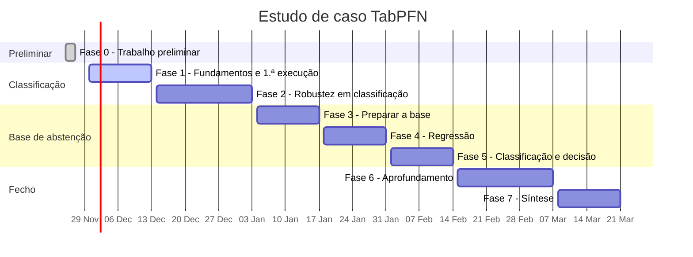

# Cronograma do estudo de caso TabPFN

**Última atualização:** 27 de novembro de 2026 · **Fase em curso:** 1 (a começar) · **Conclusão prevista:** 21 de março de 2027

Este ficheiro é a referência do plano. É atualizado sempre que uma fase muda de estado, uma data é revista ou o âmbito se altera; cada alteração fica registada no fim, em [Registo de alterações](#registo-de-alterações).

## Visão geral

| Fase | Tema | Início | Fim | Estado |
| --- | --- | --- | --- | --- |
| 0 | Trabalho preliminar | 25 nov 2026 | 27 nov 2026 | Concluída |
| 1 | Fundamentos e primeira execução | 30 nov 2026 | 13 dez 2026 | A começar |
| 2 | Robustez em classificação | 14 dez 2026 | 3 jan 2027 | Planeada |
| 3 | Preparar a base de abstenção para modelar | 4 jan 2027 | 17 jan 2027 | Planeada |
| 4 | Regressão na base de abstenção | 18 jan 2027 | 31 jan 2027 | Planeada |
| 5 | Classificação, calibração e decisão | 1 fev 2027 | 14 fev 2027 | Planeada |
| 6 | Aprofundamento: versões, escala, custo e interpretação | 15 fev 2027 | 7 mar 2027 | Planeada |
| 7 | Síntese e conclusões | 8 mar 2027 | 21 mar 2027 | Planeada |

As datas pressupõem cerca de quatro a seis horas de trabalho por semana e uma pausa no período das festas. São objetivos, não compromissos: se uma fase revelar um problema que mereça mais tempo, a data é revista e a razão fica no registo.

## Critérios comuns a todas as fases

Uma fase só passa a «Concluída» quando:

- o notebook correu de uma ponta à outra no Colab, com os resultados gravados;
- as conclusões estão escritas a partir desses resultados e incluem o que não correu como esperado;
- o `README.md` e este cronograma foram atualizados;
- a página correspondente da wiki tem o resumo da fase.

---

## Fase 0 – Trabalho preliminar

**25 a 27 de novembro de 2026 · Concluída**

Objetivo: ter um protocolo de comparação fiável e uma base de dados original pronta a usar.

- [x] Revisão crítica de um primeiro notebook de comparação entre TabPFN e LightGBM (uma só partição, sem afinação do LightGBM, tempos enviesados, conclusões escritas antes dos resultados).
- [x] Notebook 01 reescrito: cinco modelos, validação cruzada repetida, intervalos *bootstrap*, teste emparelhado corrigido, tempos separados, autenticação e licença.
- [x] Notebook 02: recolha da base por município (Censo 2022 do IBGE; resultados e perfil do eleitorado de 2026 do TSE), executado com dados reais.
- [x] Validação da base: totais nacionais coerentes com os oficiais, somas de controlo, 5 571 municípios e 61 colunas.
- [x] Dicionário de variáveis.
- [x] Primeira leitura dos dados: correlações de cada variável com a abstenção.

Ficou por fazer, e passa para a fase 1: executar o notebook 01 com o TabPFN real. Até agora só foi testado com um modelo de substituição e dados sintéticos.

## Fase 1 – Fundamentos e primeira execução

**30 de novembro a 13 de dezembro de 2026 · A começar**

Objetivo: perceber o modelo por dentro e obter os primeiros resultados reais.

- [ ] Ler o artigo do TabPFN v2 (Nature, 2025), o relatório do TabPFN-2.5 e o artigo do TabArena.
- [ ] Escrever na wiki a página «Conceitos»: redes ajustadas a dados *a priori*, aprendizagem em contexto, geração dos dados sintéticos, atenção por linhas e colunas, limites conhecidos.
- [ ] Criar conta na Prior Labs, aceitar a licença e configurar o `TABPFN_TOKEN` no Colab.
- [ ] Executar o notebook 01 no Colab com GPU, com o TabPFN v2 e com o TabPFN-3.5.
- [ ] Corrigir o que falhar na execução real e registar os resultados.
- [ ] Acrescentar o botão «Abrir no Colab» no topo de cada notebook.

Entregáveis: notebook 01 executado, página «Conceitos» na wiki, primeira entrada com resultados no diário.

Pergunta a que responde: no `credit-g`, o TabPFN distingue-se de um LightGBM afinado e de uma regressão logística?

## Fase 2 – Robustez em classificação

**14 de dezembro de 2026 a 3 de janeiro de 2027 · Planeada**

Objetivo: verificar se o que se observou num conjunto de dados se repete noutros, escolhidos para serem diferentes entre si.

| Conjunto (OpenML) | O que acrescenta |
| --- | --- |
| `churn` | Sinal forte, variáveis mistas e classe positiva minoritária |
| `phoneme` | Só variáveis numéricas e fronteira de decisão muito não linear |
| `qsar-biodeg` | Poucas linhas e muitas colunas, noutro domínio |
| `ozone-level-8hr` | Classe positiva rara e variáveis muito correlacionadas |
| `bank-marketing` | Teste de escala: fora do alcance do TabPFN v2 |

- [ ] Generalizar o notebook 01 para correr uma lista de conjuntos de dados com o mesmo protocolo.
- [ ] Confirmar as dimensões e o alvo de cada conjunto na página do OpenML.
- [ ] Produzir uma tabela por conjunto e a posição média de cada modelo.
- [ ] Discutir o risco de contaminação: conjuntos muito usados em *benchmarks* podem ter influenciado o desenvolvimento do modelo.

Entregáveis: notebook 03 (comparação em vários conjuntos), resumo na wiki.

Pergunta a que responde: a vantagem ou desvantagem do TabPFN depende do tipo de problema?

## Fase 3 – Preparar a base de abstenção para modelar

**4 a 17 de janeiro de 2027 · Planeada**

Objetivo: transformar a base recolhida num problema de modelação bem definido.

- [ ] Análise exploratória orientada à modelação: distribuição do alvo, valores extremos, padrões por região e estado.
- [ ] Definir o alvo (taxa de abstenção da 1.ª volta) e retirar as variáveis que o revelam: eleitores aptos, comparecimento, abstenções, votos e tudo o que seja da 2.ª volta.
- [ ] Tratar as variáveis que somam 100 (idade, escolaridade, classes de rendimento) e as constantes.
- [ ] Definir a validação por grupos, com os estados como grupo, e justificar a escolha.
- [ ] Estabelecer as linhas de base: média nacional, média da região e regressão linear regularizada.
- [ ] Avaliar se vale a pena acrescentar densidade populacional e taxa de urbanização do IBGE.

Entregáveis: notebook 04 (preparação e linhas de base), conjunto de variáveis final documentado.

Pergunta a que responde: quanto da abstenção municipal se explica com um modelo simples?

## Fase 4 – Regressão na base de abstenção

**18 a 31 de janeiro de 2027 · Planeada**

Objetivo: a comparação central do estudo, numa base nova e com validação exigente.

- [ ] Comparar `TabPFNRegressor`, LightGBM (valores de fábrica e afinado) e a regressão linear, com erro absoluto médio, raiz do erro quadrático médio e R².
- [ ] Aplicar o teste emparelhado corrigido às diferenças entre modelos.
- [ ] Medir a contribuição de cada grupo de variáveis (composição do eleitorado, cadastro, socioeconómicas, geografia), retirando um grupo de cada vez.
- [ ] Comparar a validação por estado com uma validação aleatória, para quantificar o otimismo desta última.
- [ ] Analisar os erros: em que municípios e regiões os modelos falham mais.

Entregáveis: notebook 05 (regressão), tabela de resultados na wiki.

Pergunta a que responde: numa base real e nova, o TabPFN prevê melhor do que as alternativas, e com que margem?

## Fase 5 – Classificação, calibração e decisão

**1 a 14 de fevereiro de 2027 · Planeada**

Objetivo: ligar a previsão a uma decisão concreta.

- [ ] Transformar o problema em classificação: municípios com abstenção no quartil superior.
- [ ] Comparar os modelos com ROC-AUC, *log loss* e Brier, e traçar curvas de calibração.
- [ ] Simular uma decisão com recursos limitados: se só for possível intervir em 500 municípios, quantos dos de maior abstenção cada modelo identifica?
- [ ] Comparar a abordagem de classificação com a de ordenar pelas previsões da regressão.

Entregáveis: notebook 06 (classificação e decisão).

Pergunta a que responde: as probabilidades do TabPFN são suficientemente fiáveis para apoiar uma decisão?

## Fase 6 – Aprofundamento

**15 de fevereiro a 7 de março de 2027 · Planeada**

Objetivo: perceber os limites e os custos, para além da qualidade das previsões.

- [ ] **Versões:** comparar o TabPFN v2 (pesos abertos) com o TabPFN-3.5 nas mesmas partições.
- [ ] **Tamanho do contexto:** curva de aprendizagem com 250, 500, 1 000, 2 000 e 4 000 linhas de treino, para o TabPFN e para o LightGBM.
- [ ] **Custo:** tempos de preparação e de previsão em GPU e em CPU; latência por linha.
- [ ] **Incerteza:** intervalos de previsão do regressor e a sua cobertura real.
- [ ] **Interpretação:** importância por permutação nos dois modelos, e se contam a mesma história.

Entregáveis: notebook 07 (limites e custos).

Pergunta a que responde: o que se ganha e o que se paga ao escolher o TabPFN?

## Fase 7 – Síntese e conclusões

**8 a 21 de março de 2027 · Planeada**

Objetivo: fechar o estudo com conclusões utilizáveis por quem tenha de escolher um modelo.

- [ ] Tabela final com todos os resultados, por conjunto de dados e por tarefa.
- [ ] Guia «quando usar cada abordagem», fundamentado nos resultados obtidos.
- [ ] Limitações do estudo e o que ficou por testar.
- [ ] Revisão de todos os notebooks: texto, reprodutibilidade e versões.
- [ ] Glossário dos termos usados.

Entregáveis: secção de conclusões no `README.md`, página de síntese na wiki, `GLOSSARIO.md`.

---

## Riscos e como são tratados

| Risco | Efeito | Resposta |
| --- | --- | --- |
| O pacote `tabpfn` ou a política de acesso aos pesos mudam | Notebooks deixam de correr | Versão fixa em `requirements.txt`; alternativa com os pesos abertos da versão 2 |
| Limites de GPU no Colab gratuito | Execuções longas interrompidas | Reduzir repetições da validação cruzada; guardar resultados intermédios em ficheiro |
| As variáveis explicam pouco da abstenção | Todos os modelos ficam próximos | É um resultado válido; a fase 4 mede-o e a fase 3 avalia variáveis adicionais |
| Conjuntos clássicos já vistos no desenvolvimento do modelo | Resultados otimistas na fase 2 | A base de abstenção, de 2026, serve de teste sem esse risco |
| Menos tempo disponível do que o previsto | Atrasos | Datas revistas e registadas; as fases 5 e 6 podem ser reduzidas sem comprometer as conclusões |

## Registo de alterações

| Data | Alteração |
| --- | --- |
| 27 nov 2026 | Primeira versão do cronograma. Fase 0 concluída. |
